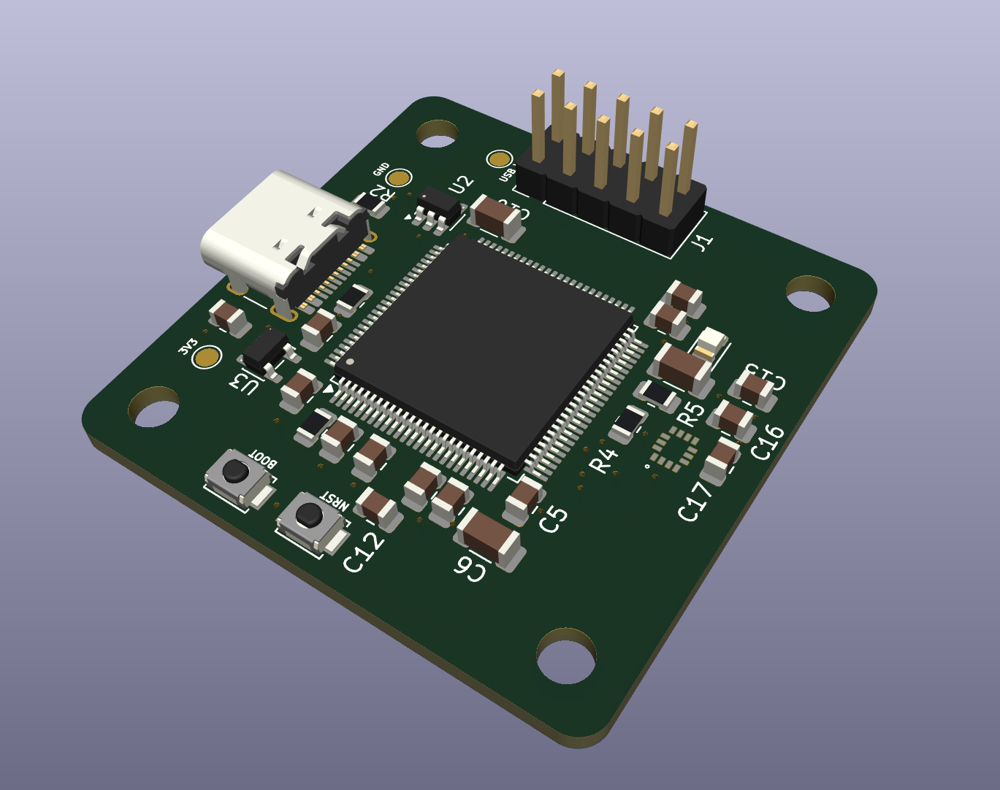
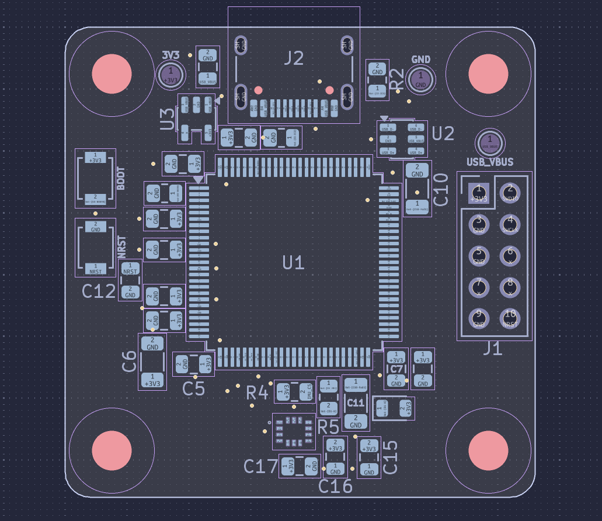
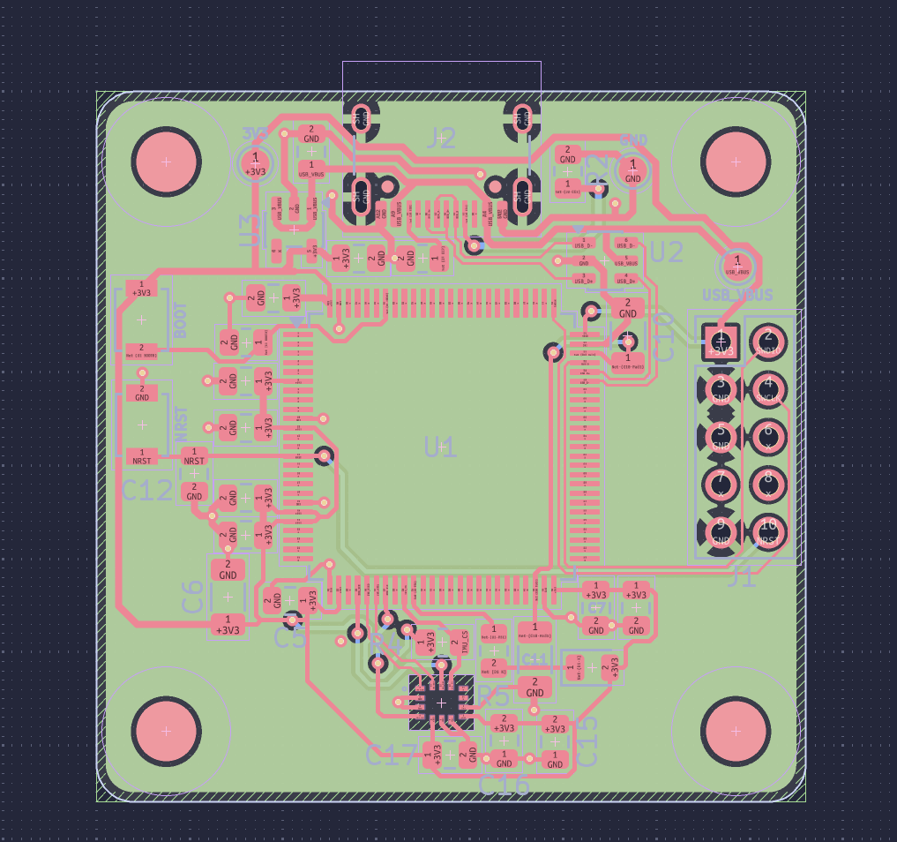

# Drone MCU

I'm building a drone flight controller from scratch and using it to explore neural networks along the way. The long-term goal is a small autonomous drone that can track a person, follow them and orbit around them. First though, I need a board that works on my desk and tells me which way is up.

This is a university project and a work in progress. There will probably be a lot of testing, debugging and coffee between a PCB and a flying drone.

## The plan

V1 is a USB-powered development board built around an STM32H743 and an IMU, the sensor that measures movement and rotation. The idea is to read that sensor on the board, send live data to a computer and show the board's orientation in a window.

I also want to train a small neural network in simulation and run it on the MCU. The computer will show what the sensor is doing alongside the network's predicted correction so I can see what it's learning before motors get involved.

The V1 testbench board is currently in production. Once it arrives, I'll start testing it on the bench. It doesn't control motors or fly. Later versions will need flight hardware, reliable stabilization, a camera, tracking and plenty of testing before they become the autonomous drone I'm aiming for.

## Where things are

- [Drone_MCU_V1](Drone_MCU_V1/) has the current KiCad project. Open [Drone_MCU_V1.kicad_pro](Drone_MCU_V1/Drone_MCU_V1.kicad_pro) to see the schematic and PCB.
- [V1 plan](Drone_MCU_V1/V1_PLAN.md) explains the goals and the work still to do.
- [Manufacturing and assembly files](Drone_MCU_V1/manufacturing/2026-11-08-quote/) contain the quote files, parts list and assembly research. The files in this folder are marked quote only, so check the review before using them for an order.
- [Reviews](Drone_MCU_V1/reviews/) contain saved design checks and notes from the board review.
- [REV_1](REV_1/) is the earlier flight controller design. I'm keeping it around as a reference while V1 gets its own fresh start.

[DECISIONS.md](DECISIONS.md) keeps the project decisions and open questions. [AGENTS.md](AGENTS.md) has context for anyone using an AI agent to help with the project.

## PCB images

Here's a look at the V1 board in KiCad before it heads to the bench.

## What's next

Test the board when it arrives, read the IMU, stream the data to a computer and build the live orientation display. After that it's time to get a neural network trained in simulation and see what the MCU can do with it.
